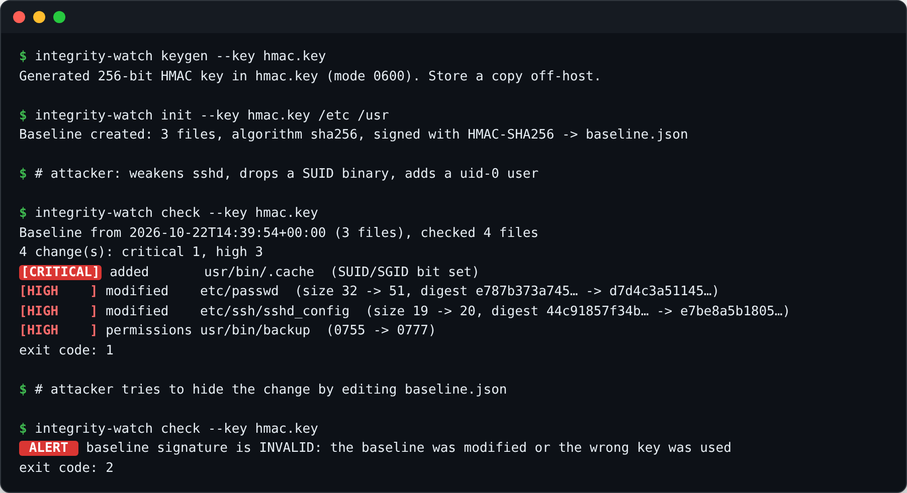

<h1 align="center">integrity-watch</h1>

<p align="center">
  <b>File integrity monitoring for Linux with a tamper-evident, HMAC-signed baseline</b><br>
  Detects modified binaries and configs, new SUID files, permission and ownership changes — and refuses to trust a baseline an attacker has edited.
</p>

<p align="center">
  
  
  
  
  
</p>

<p align="center"></p>

## The problem

After gaining root, attackers typically **modify system binaries, weaken `sshd_config`, add a UID-0 user or drop a SUID backdoor** — and then cover their tracks. Classic integrity checkers store a plain hash database; if it lives on the same host, an attacker with root simply regenerates it.

`integrity-watch` signs the entire baseline (file list, hashes, permissions, owners and the scan policy itself) with **HMAC-SHA256**. Without the key, the baseline cannot be changed without detection — the demo above shows exactly that.

## Features

- **What is monitored:** content hash, size, permissions, owner/group, file type, symlink targets (mtime-only changes are ignored to avoid noise)
- **Risk-aware severity:** new SUID/SGID file or SUID bit added → `critical`; changes in `/bin`, `/sbin`, `/boot`, `/etc/ssh`, `/etc/pam.d`, `/etc/sudoers`, `/etc/passwd`, `/etc/shadow`, `ld.so` → `high`; world-writable permissions → `high`
- **Tamper evidence:** signed baseline, constant-time signature check, atomic writes, `0600` permissions, refuses insecure or short keys
- **Hash algorithms:** SHA-256, SHA-512, BLAKE2b, SHA3-256
- **Change management:** `update` shows the diff and re-signs only after confirmation — approved changes do not create alert fatigue
- **Operations-ready:** systemd service + hourly timer with sandboxing, syslog (`authpriv`) output for SIEM, JSON output, meaningful exit codes
- **Zero dependencies:** Python standard library only, suitable for isolated and air-gapped hosts

## Quick start

```bash
git clone https://github.com/Sashagran/integrity-watch.git && cd integrity-watch

python -m integrity_watch keygen --key /secure/hmac.key
sudo python -m integrity_watch init --key /secure/hmac.key --config deploy/policy.example.json \
     --baseline /var/lib/integrity-watch/baseline.json
sudo python -m integrity_watch check --key /secure/hmac.key --baseline /var/lib/integrity-watch/baseline.json

# after an approved change (package update, config edit):
sudo python -m integrity_watch update --key /secure/hmac.key --baseline /var/lib/integrity-watch/baseline.json
```

Install as an hourly systemd timer: `sudo ./deploy/install.sh` (see [`deploy/`](deploy)).

| Exit code | Meaning |
|---|---|
| `0` | no changes |
| `1` | changes detected |
| `2` | baseline missing, malformed or **signature invalid** |
| `3` | operational error |

## Where to keep the key

The HMAC key is what makes the baseline trustworthy. In order of preference:

1. on read-only or removable media mounted only for checks;
2. in a secrets manager / on the central log server that runs checks remotely;
3. on the host, readable only by root (`0600`) — still detects tampering by non-root attackers and by attackers who don't know the tool.

## Compliance context

Integrity control of software and configuration is a mandatory measure in most security frameworks. `integrity-watch` is designed to support these requirements technically:

| Framework | Requirement |
|---|---|
| FSTEC of Russia Orders No. 17 and No. 21 | measure group **ОЦЛ** — integrity of the information system, incl. **ОЦЛ.1** software integrity control |
| PCI DSS v4.0 | 11.5.2 — change-detection mechanism for critical files |
| NIST SP 800-53 | SI-7 Software, Firmware, and Information Integrity |
| CIS Controls v8 | Secure configuration management |

> **Note.** This is an open-source tool, not a certified information security product (СЗИ). In systems that require certified tools — e.g. Astra Linux Special Edition with its built-in integrity controls — use it as a complementary monitoring and lab tool, not as a replacement.

## How it works

```text
policy (paths, excludes, algorithm)
        │
        ▼
     scan ──► FileRecord{digest, size, mode, uid, gid, type, target}
        │
        ▼
 baseline = {payload: {policy, files, created_at, host}, signature: HMAC-SHA256(key, canonical_json(payload))}
        │
check:  verify signature ──✗──► exit 2 (tampered)
        │ ✓
        ▼
     rescan with the *signed* policy ─► compare ─► changes ranked by severity ─► text / JSON / syslog
```

The scan policy is part of the signed payload, so an attacker cannot quietly exclude a directory from monitoring either.

## Tests

```bash
python -m unittest discover -s tests -v
```

16 tests cover scanning, all change types, SUID and world-writable escalation, mtime-only noise suppression, baseline tampering, wrong keys, insecure key permissions and CLI exit codes.

## Roadmap

- GOST R 34.11-2012 (Streebog) hashes via `gostsum` / OpenSSL GOST engine
- Remote mode: run checks over SSH from a trusted server holding the key
- Package-manager awareness (`dpkg --verify`, `rpm -V`) to auto-explain changes made by updates

## License

MIT © Alexander Zheltov
